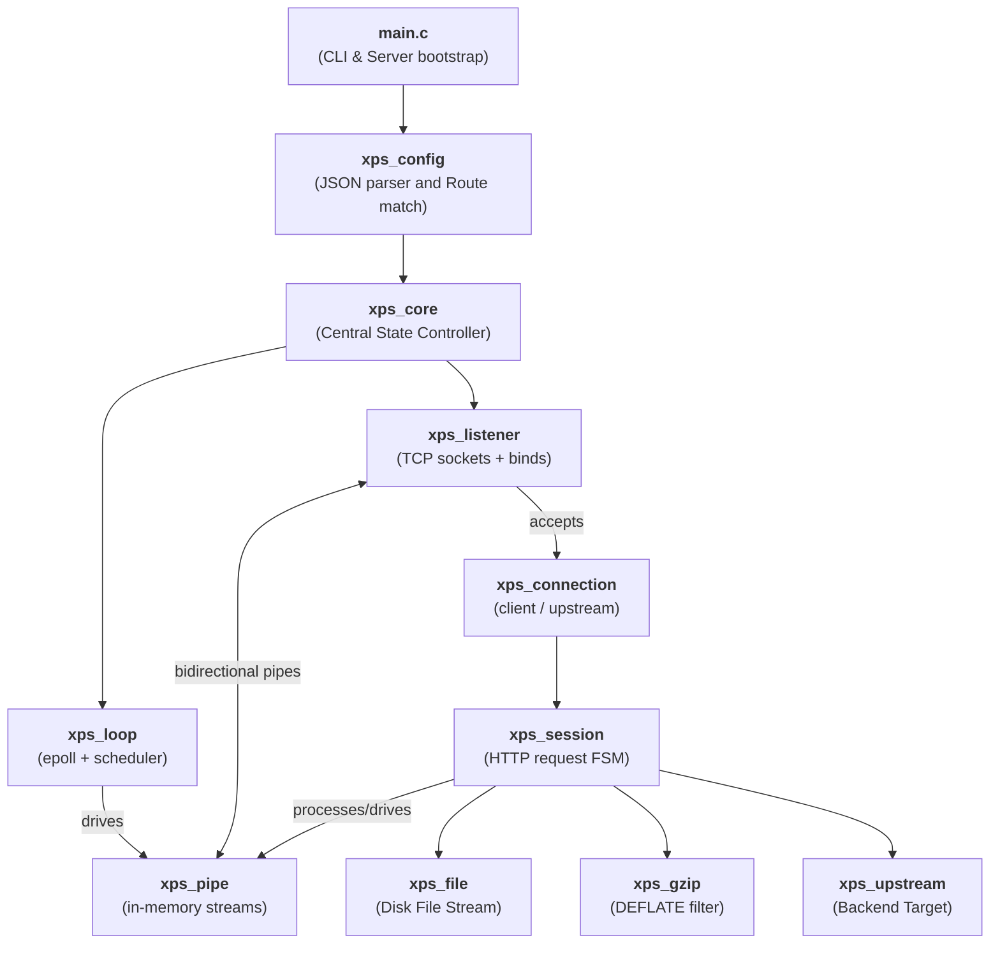
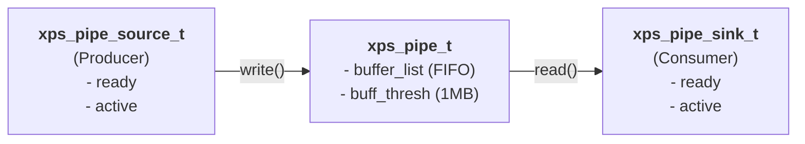
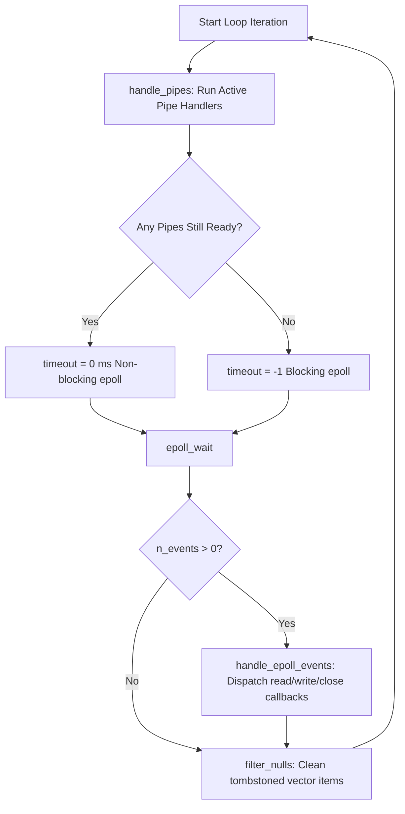
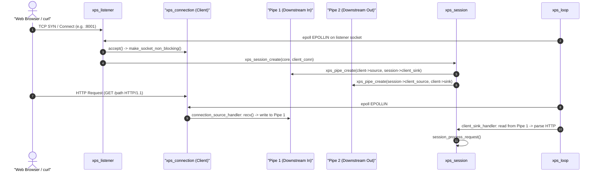
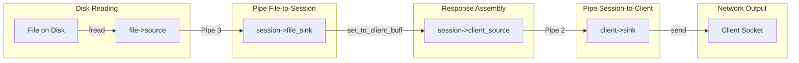
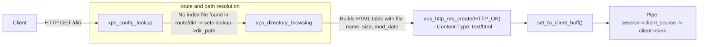
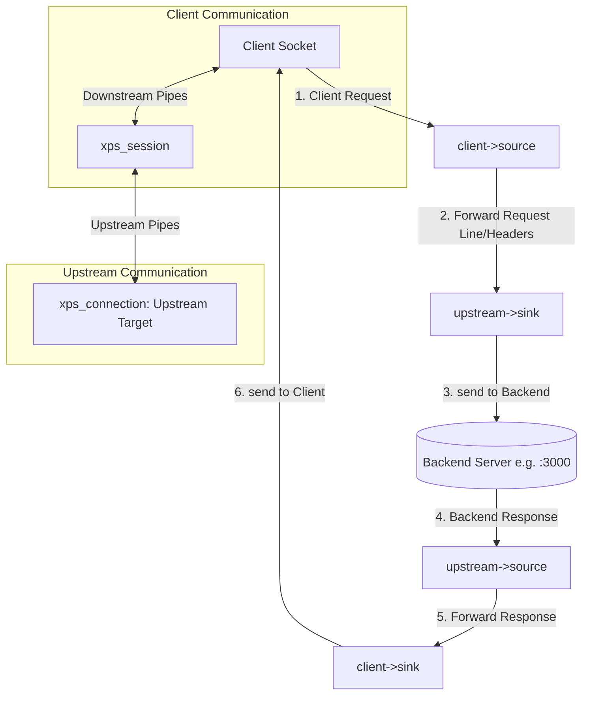

# eXpServer Architecture & Data Flow Guide

**eXpServer** is a high-performance, event-driven, non-blocking HTTP/1.1 web server and reverse proxy written in C. It employs Linux **epoll** in edge-triggered mode (`EPOLLET`) along with a custom **in-memory software pipeline abstraction (`xps_pipe`)** to stream data asynchronously with built-in backpressure and minimal memory footprint.

---

## Table of Contents

1. [High-Level Architectural Overview](#1-high-level-architectural-overview)
2. [Module Breakdown & Responsibilities](#2-module-breakdown--responsibilities)
3. [The Core Abstraction: Software Pipes (`xps_pipe`)](#3-the-core-abstraction-software-pipes-xps_pipe)
4. [Event Loop & Lifecycle Execution](#4-event-loop--lifecycle-execution)
5. [Connection Lifecycle](#5-connection-lifecycle)
6. [Data Flow in Different Connection Types](#6-data-flow-in-different-connection-types)
   - [A. Static File Serving (Uncompressed)](#a-static-file-serving-uncompressed)
   - [B. Static File Serving with Gzip Compression](#b-static-file-serving-with-gzip-compression)
   - [C. Directory Browsing (Auto-Index)](#c-directory-browsing-auto-index)
   - [D. Reverse Proxying](#d-reverse-proxying)
   - [E. HTTP Redirects](#e-http-redirects)
7. [Backpressure & Flow Control](#7-backpressure--flow-control)
8. [Error Handling & Memory Cleanup](#8-error-handling--memory-cleanup)

---

## 1. High-Level Architectural Overview

---

## 2. Module Breakdown & Responsibilities

| Directory      | Module           | Key Files                              | Primary Responsibility                                                                                                                                                                                            |
| :------------- | :--------------- | :------------------------------------- | :---------------------------------------------------------------------------------------------------------------------------------------------------------------------------------------------------------------- |
| **Root**       | `main`           | `main.c`, `xps.h`                      | Bootstraps configuration, sets up signal handlers (`SIGINT`), instantiates `xps_core`, duplicates socket listeners, and enters the event loop.                                                                    |
| **`config/`**  | `xps_config`     | `xps_config.h`, `xps_config.c`         | Uses the `parson` library to parse `xps_config.json`. Validates listeners, server names, routes, IP blacklists/whitelists, gzip settings, and performs routing lookups via `xps_config_lookup()`.                 |
| **`core/`**    | `xps_core`       | `xps_core.h`, `xps_core.c`             | Holds global runtime state: pointers to the active `xps_loop_t`, `xps_config_t`, and dynamic arrays (`vec_void_t`) of listeners, connections, pipes, and sessions. Purges inactive elements via `filter_nulls()`. |
| **`core/`**    | `xps_loop`       | `xps_loop.h`, `xps_loop.c`             | Wraps Linux `epoll`. Runs in edge-triggered mode (`EPOLLET`). Coordinates I/O event callbacks and drives software pipe data transfers via `handle_pipes()`.                                                       |
| **`core/`**    | `xps_pipe`       | `xps_pipe.h`, `xps_pipe.c`             | An in-memory unidirectional FIFO stream abstraction. Connects an `xps_pipe_source_t` to an `xps_pipe_sink_t` with a buffered queue (`xps_buffer_list_t`) and threshold-based backpressure.                        |
| **`core/`**    | `xps_session`    | `xps_session.h`, `xps_session.c`       | Represents a complete client-server conversation. Manages request ingestion, HTTP state machine parsing, route routing, upstream/file/gzip pipe construction, and session lifecycle.                              |
| **`network/`** | `xps_listener`   | `xps_listener.h`, `xps_listener.c`     | Binds non-blocking TCP sockets to configured ports, attaches them to `epoll`, and executes `accept()` loops to spawn client `xps_connection_t` and `xps_session_t` instances.                                     |
| **`network/`** | `xps_connection` | `xps_connection.h`, `xps_connection.c` | Wraps a client or upstream socket file descriptor. Implements `connection_source_handler` (socket read &rarr; pipe write) and `connection_sink_handler` (pipe read &rarr; socket send).                           |
| **`network/`** | `xps_upstream`   | `xps_upstream.h`, `xps_upstream.c`     | Creates non-blocking outbound TCP connections to backend reverse proxy targets (`connect()` with `EINPROGRESS`).                                                                                                  |
| **`http/`**    | `xps_http`       | `xps_http.h`, `xps_http.c`             | String matching utilities and HTTP constants.                                                                                                                                                                     |
| **`http/`**    | `xps_http_req`   | `xps_http_req.h`, `xps_http_req.c`     | Finite State Machine (FSM) streaming HTTP request parser. Parses method, URI, headers, host, and port without memory reallocation.                                                                                |
| **`http/`**    | `xps_http_res`   | `xps_http_res.h`, `xps_http_res.c`     | Formats and serializes HTTP response headers (status codes, headers, body length).                                                                                                                                |
| **`disk/`**    | `xps_file`       | `xps_file.h`, `xps_file.c`             | Safe disk reader confined to public directories (prevents path traversal). Uses `stat` and `fread` to stream file chunks through an `xps_pipe_source_t`.                                                          |
| **`disk/`**    | `xps_directory`  | `xps_directory.h`, `xps_directory.c`   | Scans directories and generates formatted HTML tables for directory browsing when `index.html` is absent.                                                                                                         |
| **`disk/`**    | `xps_gzip`       | `xps_gzip.h`, `xps_gzip.c`             | Dynamic zlib-based gzip/DEFLATE compression filter that sits as an intermediate pipeline stage.                                                                                                                   |
| **`disk/`**    | `xps_mime`       | `xps_mime.h`, `xps_mime.c`             | Content-Type detection based on file extensions (`.html`, `.c`, `.jpg`, `.pdf`, etc.).                                                                                                                            |
| **`utils/`**   | `xps_buffer`     | `xps_buffer.h`, `xps_buffer.c`         | Memory buffers (`xps_buffer_t`) and FIFO linked buffer lists (`xps_buffer_list_t`).                                                                                                                               |
| **`utils/`**   | `xps_logger`     | `xps_logger.h`, `xps_logger.c`         | Colorized stdout logging with levels (`DEBUG`, `INFO`, `WARNING`, `ERROR`).                                                                                                                                       |
| **`utils/`**   | `xps_utils`      | `xps_utils.h`, `xps_utils.c`           | Networking and string helper functions (`make_socket_non_blocking`, `path_join`, `vec_filter_null`).                                                                                                              |
| **`lib/`**     | `parson`, `vec`  | `parson.c`, `vec.c`                    | Third-party JSON parsing and type-safe dynamic vector arrays.                                                                                                                                                     |

---

## 3. The Core Abstraction: Software Pipes (`xps_pipe`)

Data does **not** move through ad-hoc buffer copies between modules. Instead, eXpServer standardizes all data movement using **Software Pipes**.

- **`xps_pipe_source_t` (Producer):**
  Has a `handler_cb` that produces data. Examples:
  - `connection_source_handler`: reads from network socket (`recv()`) and writes to pipe.
  - `file_source_handler`: reads from disk file (`fread()`) and writes to pipe.
  - `gzip_source_handler`: reads compressed chunks from zlib and writes to pipe.
  - `client_source_handler`: takes serialized response buffers from `session->to_client_buff` and writes to pipe.

- **`xps_pipe_sink_t` (Consumer):**
  Has a `handler_cb` that consumes data. Examples:
  - `connection_sink_handler`: reads from pipe and sends over network socket (`send()`).
  - `client_sink_handler`: reads raw request bytes from pipe and feeds the HTTP parser.
  - `gzip_sink_handler`: reads uncompressed bytes from pipe and feeds zlib deflate stream.
  - `upstream_sink_handler`: reads upstream response bytes from pipe and buffers them for the client.

- **Readiness & Flow Control:**
  - `xps_pipe_is_readable(pipe)`: Returns `true` if `buff_list->len > 0`.
  - `xps_pipe_is_writable(pipe)`: Returns `true` if `buff_list->len < buff_thresh` (default 1 MB).

---

## 4. Event Loop & Lifecycle Execution

The central engine is `xps_loop_run()` in [`core/xps_loop.c`](file:///home/acausr/Projects/eXpServer/src/core/xps_loop.c#L180):

1. **Software Pipe Pump (`handle_pipes`)**:
   Iterates through all pipes in `core->pipes`. If a pipe source is ready and writable, its handler is called. If a pipe sink is ready and readable, its handler is called.
2. **Epoll Wait Calculation**:
   If any pipes still have pending data or ready states, `timeout` is set to `0` (poll without sleeping). Otherwise, it waits indefinitely (`-1`) for network I/O.
3. **Hardware Network I/O (`handle_epoll_events`)**:
   Dispatches network events triggered by Linux kernel:
   - `EPOLLIN`: marks the connection's source as ready (`connection->source->ready = true`).
   - `EPOLLOUT`: marks the connection's sink as ready (`connection->sink->ready = true`).
   - `EPOLLERR | EPOLLHUP`: triggers connection teardown.
4. **Garbage Collection (`filter_nulls`)**:
   Cleans up destroyed objects that were set to `NULL` to avoid linear growth in internal vectors.

---

## 5. Connection Lifecycle

When a new TCP client connects:

1. `listener_connection_handler` accepts the socket, configures it as non-blocking, and creates an `xps_connection_t`.
2. `xps_session_create` creates an `xps_session_t` and binds **two primary client pipes**:
   - **Downstream Input Pipe:** `client->source` &rarr; `session->client_sink` (carries incoming HTTP request bytes).
   - **Downstream Output Pipe:** `session->client_source` &rarr; `client->sink` (carries outgoing HTTP response bytes).
3. As bytes arrive, `connection_source_handler` reads from the socket and writes into the input pipe.
4. `client_sink_handler` reads from the pipe and feeds chunks into the incremental HTTP request parser.

---

## 6. Data Flow in Different Connection Types

### A. Static File Serving (Uncompressed)

When a request resolves to a local static file:

1. **Routing:** `xps_config_lookup()` returns `REQ_FILE_SERVE` and the absolute file path.
2. **Security & Validation:** `xps_file_create()` confirms:
   - File resides within the allowed public directory (prevents directory traversal `../`).
   - File has world-readable permissions (`S_IROTH`).
   - Obtains file size and determines MIME type.
3. **Response Headers:** `xps_http_res_create(HTTP_OK)` formats the headers (`Content-Length`, `Content-Type: text/plain`, etc.), serializes them, and buffers them into `session->to_client_buff`.
4. **Piping File Content:**
   - Creates a new pipe: `file->source` &rarr; `session->file_sink`.
   - On each loop tick, `file_source_handler` reads up to 100 KB chunks into the pipe.
   - `file_sink_handler` picks up the chunk and updates `session->to_client_buff`.
   - `client_source_handler` writes `to_client_buff` into Pipe 2 (`session->client_source` &rarr; `client->sink`).
   - `connection_sink_handler` sends the bytes out to the client socket via `send()`.
5. **Completion:** When `fread()` hits EOF, `file_source_handler` destroys the `xps_file_t` and closes the source. Once all buffers drain, the session automatically cleans up.

---

### B. Static File Serving with Gzip Compression

If the client header contains `Accept-Encoding: gzip` and the matched route has `"gzip_enable": true`:

1. **Chained Pipelines:** Instead of connecting `file->source` directly to `session->file_sink`, `session_process_request` instantiates `xps_gzip_create(lookup->gzip_level)` and sets up two cascading pipes:
   - **Pipe A (Uncompressed Stream):** `file->source` &rarr; `gzip->sink`
   - **Pipe B (Compressed Stream):** `gzip->source` &rarr; `session->file_sink`
2. **Streaming Deflate:**
   - As chunks arrive into `gzip->sink`, `gzip_sink_handler` calls zlib's `deflate()` with `Z_NO_FLUSH`.
   - Compressed chunks are buffered into `gzip->transfer_buff` and emitted through `gzip->source`.
   - When the file reaches EOF and closes, `gzip_sink_close_handler` is triggered, which invokes `deflate()` with `Z_FINISH` to write the gzip trailer and checksum.
3. **Header Adjustments:** Headers specify `Content-Encoding: gzip` (omitting raw `Content-Length`).

---

### C. Directory Browsing (Auto-Index)

When a request matches a directory and no configured index file exists:

1. `xps_config_lookup()` discovers that the resource is a directory and neither `index.html` nor other index files exist.
2. It calls [`xps_directory_browsing()`](file:///home/acausr/Projects/eXpServer/src/disk/xps_directory.c#L11), which opens the directory stream (`opendir`), iterates through entries (`readdir`), obtains file info, and formats an HTML response string.
3. The HTML buffer is attached as the response body to `xps_http_res_t`, serialized into `session->to_client_buff`, and pushed through the client output pipe.

---

### D. Reverse Proxying

When the matched route specifies `"type": "reverse_proxy"` with an upstream host:

1. **Upstream Connection:** `xps_upstream_create()` initiates a non-blocking TCP connection (`socket()`, `connect()`) to the backend server (e.g. `localhost:3000`).
2. **Bidirectional Pipe Mesh:** Two bidirectional pipes bridge the client and the upstream target:
   - **Request Forwarding Pipe:** `session->upstream_source` &rarr; `upstream->sink`
   - **Response Forwarding Pipe:** `upstream->source` &rarr; `session->upstream_sink`
3. **Request Relay:** The serialized HTTP request stored in `session->from_client_buff` is written into the upstream source and dispatched to the backend via `connection_sink_handler`.
4. **Streaming Response:** As the backend server sends back data, `connection_source_handler` reads from the backend socket, passes it through `upstream_sink_handler` into `session->to_client_buff`, and flushes it to the client.

---

### E. HTTP Redirects

When a route is configured with `"type": "redirect"`:

1. The server generates an HTTP response with the specified status code (e.g. `302 Moved Temporarily`).
2. Adds the `Location: <redirect_url>` header.
3. The serialized header buffer is written immediately to the client socket, and the session closes.

---

## 7. Backpressure & Flow Control

Because eXpServer handles streaming for large files and fast upstream connections, it prevents unbounded memory growth via **threshold-based pipe backpressure**:

1. Every pipe has a `buff_thresh` (default `1,000,000` bytes / 1 MB).
2. When the buffer list reaches `pipe->buff_thresh`:
   - `xps_pipe_is_writable(pipe)` evaluates to `false`.
   - The loop scheduler stops invoking `pipe->source->handler_cb`.
   - **Upstream throttles automatically:**
     - If the client is slow to download, `client->sink` cannot empty Pipe 2.
     - `session->to_client_buff` remains occupied.
     - `file_sink_handler` or `gzip_sink_handler` pauses reading.
     - The disk file reader stops calling `fread()`.
3. Once the client socket flushes data over TCP (`EPOLLOUT`), space frees up in the pipe (`len < buff_thresh`), and the source resumes reading!

---

## 8. Error Handling & Memory Cleanup

The server cleans up resources using deterministic lifecycle tracking:

- **Session Destruction (`session_check_destroy`):**
  A session remains active only as long as data is flowing in one of its pipelines:
  - Client-to-Upstream flow active
  - Upstream-to-Client flow active
  - File-to-Client flow active
    Once all sources and sinks indicate inactive and all intermediate buffers (`to_client_buff`, `from_client_buff`) are `NULL`, `xps_session_destroy()` frees all associated pipes and structures.
- **Tombstoning (`filter_nulls`):**
  When connections, listeners, or pipes are closed, their pointers in the `vec_void_t` arrays are set to `NULL` to prevent index corruption. Once the count exceeds `DEFAULT_NULL_THRESH` (32), `vec_filter_null()` compacts the arrays.
- **Signal Handling:**
  A `SIGINT` (Ctrl+C) signal triggers `sigint_handler()`, which calls `xps_core_destroy()`, closing all sockets, tearing down listeners, and freeing all allocated memory cleanly.
